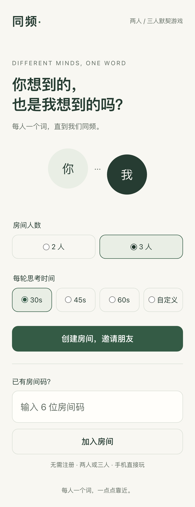
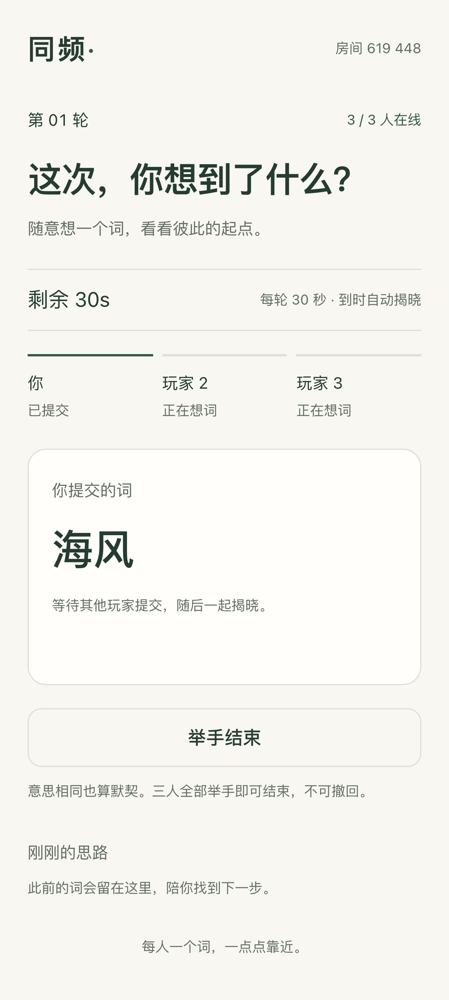

# 同频

两三个人，每轮各写一个词，直到想到一起。

手机浏览器里的两／三人默契游戏，无需注册。使用 **Vue 3 + TypeScript + Fastify + Socket.IO + SQLite**，不需要 Redis 或外部 API。

## 项目预览

当前项目实际运行的手机界面截图：

<table>
  <tr><th>创建与加入</th><th>三人对词</th></tr>
  <tr>
    <td></td>
    <td></td>
  </tr>
</table>

## 怎么玩

1. 创建房间时选择两人或三人，以及每轮30、45、60秒或自定义5–3600秒。朋友通过邀请链接或六位房间码加入，满员自动开始。
2. 每轮各自输入一个词，提交后不能修改。全员提交立即揭晓；倒计时结束统一揭晓，未提交的位置标记「未作答」。
3. 全员文字完全相同，自动结束；否则自动进入下一轮，上一轮词语保留在输入框上方供参考，无需再次点击确认。
4. 意思相同也可以全员各自点击「举手结束」。举手不可撤回，单方举手后仍可以继续对词。
5. 结束后查看记录，全员点击「再来一局」重新开始。

词语长度为1–30个Unicode字符，只忽略首尾空格，不做AI语义判断。超时即使全员未作答也自动续轮，「未作答」不算匹配；举手结束时尚未揭晓的轮次不计入结果。页面展示最近100轮和准确总轮数。

刷新、断线和服务重启后，通过原浏览器保存的身份恢复游戏。各位玩家请使用不同手机或不同浏览器身份；同一浏览器再次打开同一房间会恢复原来的位置。24小时无人操作的房间过期，自动超时续轮不会延长有效期。断线不暂停计时；服务器重启后结算到期当前轮，再从新的完整时长开始，不补跑停机期间的空轮。

## 本地运行

需要 **Node.js 24** 和 **pnpm 12.4.2**。

```sh
pnpm install --frozen-lockfile
pnpm dev
```

电脑打开 [localhost:5173](http://localhost:5173)。手机与电脑连接同一个Wi-Fi，打开Vite终端显示的Network地址。

```sh
pnpm typecheck
pnpm test
pnpm build
pnpm start
```

生产构建由后端统一服务网页与实时通信，默认 [localhost:3001](http://localhost:3001)。SQLite默认保存在 `apps/server/data/tongpin.db`。`DATABASE_PATH` 可指定绝对路径；`HOST`、`PORT`、`WEB_ROOT`、`ALLOWED_ORIGIN` 通过进程环境配置，参见 [.env.example](.env.example)。开发脚本不会自动读取根 `.env`。

端到端测试：

```sh
pnpm exec playwright install --with-deps chromium
pnpm test:e2e
# 验证已启动的生产服务
PLAYWRIGHT_BASE_URL=http://127.0.0.1:3001 pnpm test:e2e
```

## 下载与部署

[Releases](https://github.com/xc66xc/tongpin/releases) 提供Linux x86_64的Docker镜像包及SHA256校验文件。下载后执行：

```sh
sha256sum -c SHA256SUMS
docker load -i tongpin-v0.1.2-linux-amd64.docker.tar.gz
docker run -d --name tongpin --restart unless-stopped \
  -p 3001:3001 -v tongpin-data:/app/data tongpin:v0.1.2
```

打开 `http://服务器地址:3001/`。上述包是可运行镜像；GitHub自动生成的Source code压缩包是源码，需要构建。其他架构可使用Dockerfile自行构建，本次不将Linux x86_64构建声明为全平台产物。

有域名时可通过Caddy配置HTTPS：将域名指向服务器，开放80/443端口，在根 `.env` 写入 `DOMAIN=play.example.com`，运行：

```sh
docker compose up -d --build
docker compose ps
docker compose logs --tail=100 app
```

默认单实例部署，SQLite保存在持久卷。升级到0.1.2时会事务迁移旧双人数据库；旧房默认两人30秒，原无计时的进行中房间在身份恢复后启动计时。升级前请备份，若需回滚旧程序，必须停止新实例并恢复升级前数据库，不能让旧版程序操作新三人房间。重建容器保留数据；`docker compose down -v` 会删除数据卷。备份可停服务后复制数据卷，或使用SQLite在线备份接口；运行时不要只复制主db文件而忽略WAL。容器日志10MB×3轮转，不记录词语或玩家凭证。

挂在子路径时，构建镜像设置 `--build-arg WEB_BASE_PATH=/tongpin/`，反向代理剥离前缀后转发至后端，Socket.IO会使用相同前缀。系统依赖构建镜像源可通过 `DEBIAN_MIRROR` 指定，默认Debian原站。

## 验证与边界

真实Socket.IO与SQLite测试覆盖两／三人、词语保密、并发提交、全员举手、限时结算、迟到请求、双标签页、断线与服务重启恢复；浏览器测试覆盖手机视口完整游戏及房间设置。

适合低频文字互动。SQLite同步短事务存在并发上限，页面历史限制为最近100轮，超长房间清理开销仍随库内轮数增长。未承诺生产并发容量，也未将Chromium手机视口模拟等同于真实iPhone Safari验证。根 `package.json` 是唯一应用版本来源，正式版本由annotated Tag触发构建和Release。

## 许可证

[MIT](LICENSE)。

## 赞赏支持

项目免费开源。如果它对你有帮助，欢迎自愿支持维护；不影响任何功能的使用。

<table>
  <tr><th>支付宝</th><th>微信支付</th></tr>
  <tr>
    <td></td>
    <td></td>
  </tr>
</table>
